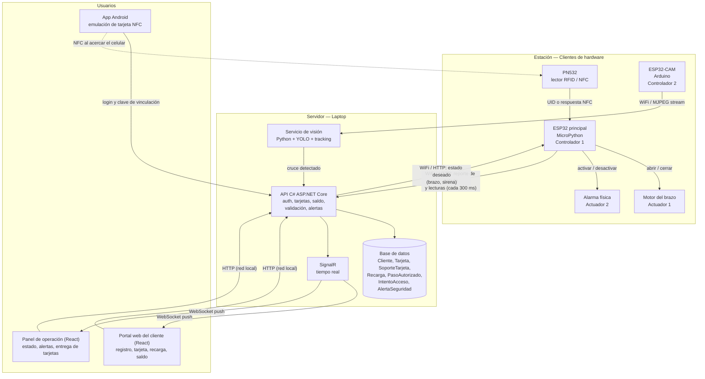

# TransitGate — Arquitectura del sistema (versión 2)

Torniquete inteligente para estaciones tipo metro o Transmilenio, con validación por tarjeta física o celular (NFC), detección de colados por visión artificial y portal web para clientes y operadores.

---

## 1. Contexto y motivación

El escenario es una estación de Transmilenio o un alimentador en Bogotá: un usuario llega, necesita una tarjeta y encuentra una fila enorme en la taquilla. Con TransitGate puede hacerlo todo desde la web en su celular: crear su cuenta, solicitar una tarjeta física o convertir su celular en tarjeta, recargar saldo y pasar el torniquete acercando el teléfono.

Respecto a la versión anterior, el sistema cambia en tres puntos:

- **Se eliminan los sensores PIR.** El cruce de personas y la detección de colados los hace un **ESP32-CAM** cuyo video se analiza en el servidor con **YOLO**.
- **El lector RFID pasa a ser un PN532** compatible con NFC, que lee tarjetas físicas y también celulares Android que emulan una tarjeta.
- **La web deja de ser solo de monitoreo.** Ahora es el portal del cliente (registro, solicitud de tarjeta, vinculación del celular, recarga, saldo e historial) y el panel de operación y seguridad.

Esta revisión incorpora, además, tres ajustes que surgieron al escribir los RF y RNF v2:

- La entidad **`PasoAutorizado`**, separada de `IntentoAcceso`.
- El estado **`ModoRegistro`** del torniquete, antes solo mencionado como una acción del operador.
- El patrón **estado deseado** entre el servidor y el ESP32 principal (en vez de órdenes puntuales), para que el ESP32 pueda reiniciarse sin perder sincronía.

**Actualización (9 oct 2026):** la web se construye en **React (Vite)** y la API la sirve en el mismo puerto (sección 7 y contratos de integración v1.2, C6).

---

## 2. Componentes

### 2.1 Clientes (hardware en la estación)

| Elemento | Rol | Tecnología | Clasificación |
| --- | --- | --- | --- |
| ESP32 principal | Coordina lector, motor y alarma; se comunica con el servidor | MicroPython | Controlador 1 |
| ESP32-CAM | Captura y transmite video del torniquete (vista cenital) | Arduino (CameraWebServer) | Controlador 2 |
| PN532 | Lee tarjetas MIFARE y celulares Android por NFC | I2C/SPI al ESP32 | Sensor |
| Cámara OV3660 | Integrada en el ESP32-CAM | — | Sensor |
| Motor del brazo | Abre y cierra el torniquete | Controlado por el ESP32 | Actuador 1 |
| Alarma física | Sirena junto al torniquete en caso de fraude | Controlada por el ESP32 | Actuador 2 |

Con esto se cumple el requisito del curso: **dos controladores** (ESP32 y ESP32-CAM) y **dos actuadores** (motor y alarma).

El ESP32 principal no toma decisiones de negocio: cada ~300 ms consulta al servidor, le reporta su estado real (lecturas nuevas incluidas) y recibe de vuelta el **estado deseado** del torniquete (brazo, sirena). El ESP32-CAM tampoco analiza nada; solo transmite video.

### 2.2 Servidor (laptop)

- **API en C# (ASP.NET Core):** usuarios y login, tarjetas y soportes, saldo y recargas, validación de pasos, historial y alertas. También sirve los archivos de la web.
- **Base de datos (Entity Framework Core):** `Cliente`, `Tarjeta`, `SoporteTarjeta`, `Recarga`, `Torniquete`, `PasoAutorizado`, `IntentoAcceso`, `AlertaSeguridad`.
- **Servicio de visión (Python + Ultralytics YOLO):** recibe el stream del ESP32-CAM, detecta personas, hace tracking (ByteTrack) y cuenta cruces sobre una línea virtual. Reporta cada cruce a la API.
- **SignalR:** empuja en tiempo real el saldo actualizado al cliente y los eventos y alertas al panel de seguridad.

### 2.3 Web y app móvil

- **Portal del cliente (web responsiva en React):** registro, login, solicitud de tarjeta física, vinculación del celular, recarga, consulta de saldo e historial de viajes.
- **Panel de operación y seguridad (web en React):** estado del torniquete en vivo, historial de pasos, alertas de colados y entrega de tarjetas solicitadas.
- **App Android (Kotlin):** su única función es emular la tarjeta por NFC (Host Card Emulation). El cliente inicia sesión con la misma cuenta de la web.

> **Por qué hace falta una app y no solo la web:** el navegador (Web NFC) solo puede leer y escribir etiquetas NFC; no puede hacer que el celular se comporte como una tarjeta. La emulación requiere una app nativa Android.

---

## 3. Diagrama de arquitectura

---

## 4. Modelo de tarjeta

- La **tarjeta es la cuenta lógica**: tiene el saldo y el historial de viajes.
- Toda tarjeta está ligada obligatoriamente a un **cliente registrado**, y **un cliente solo puede tener una tarjeta**.
- La tarjeta se usa mediante un **soporte**:
  - **Físico:** tarjeta MIFARE identificada por su UID.
  - **Virtual:** celular Android con la app, identificado por una clave secreta de vinculación (no por el UID, que en Android cambia en cada acercamiento).

Estados de la tarjeta física: `Solicitada` → `Entregada` → `Activa` → `Bloqueada` (por pérdida o reporte).

### 4.1 Estados del torniquete

El torniquete se modela como máquina de estados en el servidor:

`Cerrado` → `EsperandoCruce` → `Cerrado`, o → `Alarma`

y un cuarto estado, **`ModoRegistro`**: se activa cuando el operador pone el lector en modo registro para ligar el UID de una tarjeta física nueva (sección 5.1); dura como máximo 60 s y cualquier cruce detectado mientras está activo se trata como fraude y lo cancela. La conexión del torniquete (en línea / sin conexión) no es un estado; se lleva aparte, como la hora de la última señal de vida.

Cada validación exitosa crea un `PasoAutorizado` en estado `Pendiente`, que pasa a `Consumido` cuando la visión reporta el cruce correspondiente, a `Expirado` si nadie cruza a tiempo, o a `Revertido` si el ESP32 no confirma que el brazo abrió.

---

## 5. Flujos del sistema

### 5.1 Registro y obtención de la tarjeta desde la web

1. El cliente entra a la web desde su celular, crea su cuenta e inicia sesión.
2. Se crea su `Tarjeta` lógica con saldo cero.
3. Elige cómo usarla:
   - **Celular como tarjeta:** instala la app Android e inicia sesión. El servidor registra un `SoporteTarjeta` virtual y entrega a la app una clave secreta. El celular ya funciona como tarjeta.
   - **Tarjeta física:** la solicita desde la web y queda en estado `Solicitada`. En la taquilla, el operador pone el lector en modo registro (el torniquete entra en `ModoRegistro`), acerca una tarjeta nueva y el servidor liga ese UID a la cuenta. No tiene que hacer la fila de compra, solo recogerla.

### 5.2 Recarga y consulta de saldo

1. Desde el portal web el cliente recarga saldo. Para el proyecto el pago es **simulado** (no se integra una pasarela real).
2. El servidor registra la `Recarga` y actualiza el saldo.
3. El cliente consulta en cualquier momento su saldo y el historial de viajes; ambos se actualizan en vivo por SignalR.

### 5.3 Paso por el torniquete

1. **Reposo:** brazo cerrado, alarma apagada.
2. El cliente acerca la tarjeta o el celular al PN532.
   - **Tarjeta física:** el ESP32 lee el UID.
   - **Celular:** el ESP32 envía un número aleatorio (desafío); la app responde con una firma calculada con su clave secreta (respuesta).
3. El ESP32 envía la lectura al servidor.
4. El servidor identifica la tarjeta, verifica que tenga cliente, que esté activa y que tenga saldo suficiente.
5. **Si es válida:** debita la tarifa, registra un `IntentoAcceso` exitoso, crea un `PasoAutorizado` en estado `Pendiente` y responde con el estado deseado "brazo abierto". El ESP32 abre el brazo y el nuevo saldo aparece al instante en la web del cliente.
6. **Si no es válida** (sin saldo, bloqueada o no vinculada): el brazo no abre y se registra un `IntentoAcceso` rechazado.

### 5.4 Detección de colados (reemplaza al PIR)

1. El ESP32-CAM transmite continuamente el video del torniquete al servicio de visión.
2. YOLO detecta personas y el tracking les asigna un ID; cada ID que cruza la línea virtual cuenta como un paso.
3. El servicio de visión reporta cada cruce a la API.
4. El servidor compara **cruces contra pasos autorizados**:
   - **Un cruce con un `PasoAutorizado` pendiente:** paso normal; el paso pasa a `Consumido` y el servidor ordena cerrar el brazo.
   - **Más cruces que pasos autorizados, o un cruce sin validación:** se marca `FraudeSinValidacion`, se crea una `AlertaSeguridad` y se ordena al ESP32 activar la alarma física y mantener el brazo bloqueado.
5. Si nadie cruza dentro del tiempo límite, el `PasoAutorizado` pasa a `Expirado` y el brazo se cierra.

### 5.5 Monitoreo y atención de alertas

1. El panel de operación muestra en vivo cada paso, rechazo y alerta.
2. Ante una `AlertaSeguridad`, el personal la atiende, apaga la alarma desde el panel y la marca como resuelta.

---

## 6. Seguridad

- **Desafío-respuesta en el celular:** el servidor genera el desafío y lo envía en la consulta; es de un solo uso, expira a los 30 s y la firma incluye el id del torniquete. Como el desafío cambia en cada paso, una respuesta grabada no sirve para volver a entrar.
- **Tarjetas físicas:** el UID de MIFARE Classic puede clonarse; se documenta como limitación conocida del prototipo.
- **Privacidad del video:** no se almacenan imágenes; solo se guardan los eventos (cruces, alertas). Esto se alinea con la Ley 1581 de 2012 de protección de datos.
- **Autenticación en la web:** cada cliente solo puede ver y recargar su propia tarjeta.

---

## 7. Decisiones técnicas

| Decisión | Justificación |
| --- | --- |
| API en C# (ASP.NET Core) | SignalR resuelve el tiempo real; Entity Framework mapea limpio el modelo de dominio |
| Web en React (Vite), servida por la API | La integrante del frontend domina React; al servir el build desde la misma API (mismo puerto) se evita CORS y la cookie de sesión funciona igual en el portal y en SignalR. Los tipos de la web se generan desde el OpenAPI de la API |
| Visión en Python separado | YOLO (Ultralytics) es nativo en Python; el servicio queda desacoplado de la API |
| ESP32 principal en MicroPython | Lógica sencilla de E/S; el servidor toma las decisiones |
| ESP32-CAM en Arduino | El soporte de cámara en Arduino es más maduro y estable que en MicroPython |
| Cámara en vista cenital | Separa mejor a dos personas pegadas; de frente o de lado se tapan entre sí |
| YOLO preentrenado primero | Se usa la clase `person`; solo se afina con datasets de Roboflow Universe o imágenes propias si falla en el ángulo del montaje |
| App Android solo para NFC | La web no puede emular tarjetas; todo lo demás queda en la web |
| Estado deseado en vez de órdenes | El ESP32 consulta cada 300 ms y aplica el estado deseado; aplicarlo dos veces no tiene efecto, lo que resuelve el reinicio sin perder sincronía |
| Todo por HTTP en red local, sin túnel | El internet de la universidad no es confiable; se prioriza que la demo no dependa de un túnel externo (Cloudflare Tunnel/ngrok) sobre tener HTTPS |

---

## 8. Limitaciones conocidas

- **iPhone no puede usarse como tarjeta:** Apple restringe la emulación de tarjetas a acuerdos comerciales. Los usuarios de iPhone usan tarjeta física.
- **Dependencia de la red:** el torniquete depende del WiFi y del servidor para validar.
- **Condiciones de luz:** la cámara del ESP32-CAM pierde precisión con poca iluminación.
- **Sin cifrado en tránsito:** al usar HTTP local en vez de un túnel con HTTPS, las credenciales, la cookie de sesión y el token de la app viajan sin cifrar dentro de la red WiFi de la demo. Se acepta como limitación del prototipo a cambio de no depender de un túnel externo.

---

## 9. Decisiones de despliegue

Las decisiones pendientes de la versión anterior ya se resolvieron:

- **WiFi/servidor caído, soportes por cliente, tarifa:** resueltos como supuestos S1–S3 en los requisitos funcionales v2.
- **Contrato de la API:** rutas y formato JSON entre ESP32, servicio de visión y servidor — ver [`TransitGate_Contrato_API.pdf`](./TransitGate_Contrato_API.pdf). Las interfaces que no son HTTP (APDU, stream, pines, configuración, SignalR y simuladores) están en [`TransitGate_Contratos_de_integracion.md`](./TransitGate_Contratos_de_integracion.md).
- **Red WiFi:**
  - **Demo:** hotspot o router de un amigo, WiFi de 2,4 GHz con WPA2-Personal (RNF-36), laptop con IP fija dentro de esa red.
  - **Desarrollo:** por ahora la red de esta PC; los datos (SSID, contraseña, IP) se agregan al `config.json` del firmware cuando arranque la programación (Fase 1).
- **HTTP vs. HTTPS (antes "Opción A/B"):** se descarta el túnel (Cloudflare Tunnel/ngrok). Todo el tráfico —ESP32, ESP32-CAM, web y app— va por HTTP dentro de la red local, sin depender del internet de la universidad. Ver la limitación correspondiente en la sección 8.
- **Web:** el build de React se copia a `wwwroot` de la API y se sirve en `http://<laptop>:5000`; en desarrollo, Vite corre en el puerto 5173 con proxy hacia la API.
